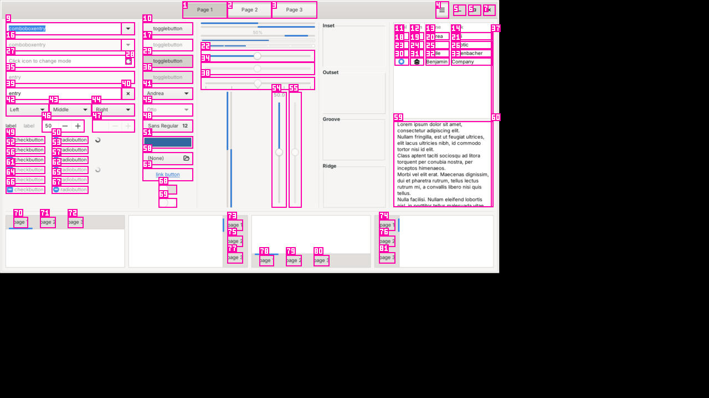

# Kai

**Give Gemma a hand.** Kai is an open-source desktop app for Linux, Windows
and macOS (Apple Silicon) that lets Gemma 4 use your computer: it looks at the screen, decides, clicks,
types and runs commands one visible step at a time, while you watch and can
stop it instantly.

Gemma 4 runs on your own DigitalOcean GPU Droplet (open weights, served by
vLLM), with Google's Gemini API as an automatic fallback.

MIT licensed · Rust · GPUI + [Ely GPUI Components](https://github.com/ZacharyZhang-NY/Ely-GPUI-Components)



*A real frame Kai sent while testing on Linux: every button and field from the
accessibility tree, numbered, so Gemma answers "click #14" instead of guessing
pixels.*

## What it does

- **Point-and-click tasks:** "Open bmsce.ac.in and find the IEEE CS page",
  "Play lofi hip hop on YouTube", "Fill this form with my details".
- **Terminal tasks:** "Find the 5 biggest files in Downloads", "Rename every
  photo in ~/Pictures/trip with today's date". Kai runs the command and reads
  the output.
- **Security check-ups of your own things:** a read-only review of a website
  you own (certificate, redirects, security headers, SPF/DMARC) and of your own
  PC (firewall, updates, listening services). Kai confirms ownership first and
  asks before changing anything.
- **Sub-agents:** turn on *Team* and Kai splits a task into parallel
  sub-agents — terminal subtasks run at the same time, screen subtasks take
  turns — then writes one report.
- **Web tasks in Kai's own browser (experimental, Linux and macOS):** `kai run
  --browser` drives a Chromium-family browser over the DevTools Protocol
  instead of the desktop: the page's own accessibility tree, input that never
  moves your pointer or takes focus, and the real page address for checks.
  Same marks, same actions, same safety rules. Measured with Gemma 4 26B
  on the four local web tasks: 8/8 vs 7/8 on the desktop, with half the
  steps, tokens and time ([docs/BROWSER.md](docs/BROWSER.md)).
- **Fully offline:** Holo3.1 4B (H Company, Apache-2.0) runs locally in
  about 4.4 GB of RAM (`kai models install holo-3.1-4b-q4`); see
  [docs/LOCAL_MODELS.md](docs/LOCAL_MODELS.md).
- **A store of open models:** 17 pinned, hash-checked models ranked for your
  computer (Gemma 4, Holo4, Holo3.1, Fara, Qwen, GLM, UI-TARS), and any
  other GGUF vision model on Hugging Face with `kai models search` and
  `kai models pull <owner/repo>` ([docs/MODEL_STORE.md](docs/MODEL_STORE.md)).
- **Skills:** reusable know-how in the Agent Skill Open Standard. Finish a run,
  press **Save as skill**, and the next run of that task skips steps the model
  no longer needs to think about.

## Architecture

```
crates/
  kai-core   the harness: loop, schema, risk, prompts, skills, sub-agents,
             model backends (vLLM, Gemini, failover, mock). OS-free, tested.
  kai-os     eyes and hands: capture, AT-SPI / UI Automation / macOS AX,
             Set-of-Marks, input, launcher, shell, kill switch, keychain.
             Linux, Windows, macOS.
  kai-cli    `kai`: run tasks headless, validate skills, benchmark, doctor.
  kai-app    the desktop app (GPUI + Ely).
deploy/digitalocean   one-command GPU Droplet with vLLM + Caddy TLS.
skills/               9 shipped skills.   bench/   10 benchmark tasks.
```

The loop is **observe → ground → decide → act → verify**, one action per step.
Full explanation with a diagram: [docs/HARNESS.md](docs/HARNESS.md).

## Why it's fast

- **MoE by default.** `gemma-4-26b-a4b-it` (~4B active parameters) for every
  step; the dense 31B only for the one step after a failure.
- **Prefix caching.** Stable system prompt and schema first, the changing
  screenshot and last 3 steps last, so vLLM reuses the cached prefix.
- **Small replies.** Thought ≤ 25 words, 192 max tokens, temperature 0,
  schema-constrained output on vLLM (no retries).
- **Skip the model when possible.** `open_app`, `open_url` and skills'
  deterministic steps go straight to the OS.
- **Cheap eyes.** Capture and accessibility tree in parallel, SIMD downscale to
  Gemma 4's 280-token budget (1070x602 for 16:9), a built-in bitmap font for
  the marks.
- **Parallel sub-agents** for independent terminal work.
- **Fewer steps.** Up to 3 certain follow-up actions per model call (type,
  then Enter), accessibility actions instead of mouse moves, tree-only steps
  without a screenshot when text is enough, and a plan cache that replays the
  known-good opening of a repeated task.

**Measured** (this repo's Linux CI container, 4 vCPU, no GPU, virtual display):

| What | p50 | p95 |
| --- | --- | --- |
| Kai's own overhead per step (capture, tree, encode, act; model excluded) — `kai bench --backend replay`, 5 real tasks, 5/5 passed | 65 ms | 93 ms |
| Observe (capture ‖ tree, then encode), 81-element GTK window | ~200 ms | — |

### Head-to-head (measured 2026-10-10)

Same Kai harness, same 14 everyday tasks from `bench/tasks.yaml` (web search,
forms, download, files, archive, folder, text editor, closing an app,
calculator, calendar, image resize, screenshot), same Linux container (Xvfb
1920x1080, 4 vCPU), same Kai build, one run each. A task passes only if its
automatic `check` command passes after the run.

| | Gemma 4 26B-A4B | Gemma 4 31B | GPT-5 mini | GPT-4.1 mini |
| --- | --- | --- | --- | --- |
| Served by | Gemini API (free tier) | Gemini API (free tier) | Vercel AI Gateway (free tier) | Vercel AI Gateway (free tier) |
| Tasks passed | **14 / 14** | 11 / 14 | 12 / 14 | 8 / 14 |
| Steps, all 14 tasks | 75 | **60** | 212 | 155 |
| Model calls | 104 | **68** | 163 | 113 |
| Tokens in / out | 185k / 9k | **113k / 7k** | 348k / 25k | 252k / 11k |
| Model time per call, p50 / p95 | 2.85 / 6.5 s ¹ | 27.2 / 43.2 s ² | 2.17 / 4.6 s | **1.77** / 3.4 s |

¹ Over Gemma's full 30-task run. Gemma 4 26B on all 30 tasks: **23 / 30**
(failures: `local-price-lookup`, `mousepad-line-numbers`, `spreadsheet-budget`,
`csv-total`, `email-draft`, `dark-mode`, `pc-checkup`; the line-numbers failure
was a Kai bug — starting a GUI app as a shell command blocked for 180 s — fixed
after this run).

² Gemma 4 31B on the Gemini API free tier is slow and flaky (many 500/429
replies, retried on the next key; the waits are not counted, but single calls
still took ~27 s). Its 31B failures: `web-form-submit`, `close-app`,
`calendar-event`. A 31B speed number from our own Droplet is not measured.

Read with care: one run per model, so a 1–2 task gap on 14 tasks is not
statistically solid; free tiers added rate-limit waits, so wall-clock task time
is not compared (model time per call excludes those waits). Raw results:
`bench/results/2026-10-10-*.json`; reproduce with `kai bench --backend gemini
--model gemma-4-26b-a4b-it` and `kai bench --backend gateway --model
openai/gpt-5-mini`.

**Fast executor (experimental, off by default).** Gemma can hand a short plan
to a local decision model, [jevos-v4](https://github.com/feder-cr/jev) (1B, CPU),
which picks the element for each step and acts only when confident
([docs/EXECUTOR.md](docs/EXECUTOR.md)). Measured here: ~140–210 ms per jevos
request; on the same 14 tasks (one run each) Gemma alone passed 13/14 and Gemma
+ jevos 11/14, but jevos acted only twice — Gemma rarely gave a plan — so this
shows no measurable benefit yet, and the gap is run-to-run noise (rate limits,
one early "done"). Turn it on with `kai bench --executor` to try it.

**Live re-run (2026-10-12, Gemma 4 26B on the Gemini API, same 14 tasks,
two runs per side).** Fixes from watching Gemma's live runs (empty shell
replies, repeated commands, a misleading "screen has not changed" after
silent commands, honouring the API's retry delay) cut steps by 25%, model
calls by 34% and input tokens by 36% (27/28 vs 28/28 passed). No
experimental switch earned a default; details in
[bench/results/2026-10-12-live.md](bench/results/2026-10-12-live.md).

**Not measured:** Gemma on our own DigitalOcean Droplet (no GPU here); GPT-6
Astra and Gemma 4 31B on the Gateway (free tier: 403); OpenAI's native
computer-use loop (needs a direct OpenAI key — implemented, tested only against
a mock); Jev (free tier: 403). How we plan to make Gemma beat frontier models:
[docs/ROADMAP.md](docs/ROADMAP.md).

## Why you can trust it

- **You see everything.** The mini window shows what Kai is doing right now;
  the run view shows every frame it sent and every action it took, with
  timings.
- **You handle CAPTCHAs, codes and questions.** At a CAPTCHA, a one-time
  code or a sign-in approval, Kai stops and notifies you; it never solves a
  CAPTCHA or guesses a code. Give it the code and it types it in (the model
  never sees it); answer its question and it carries on.
  [docs/HUMAN_CHECKS.md](docs/HUMAN_CHECKS.md)
- **Risky actions ask first.** Sending, buying, deleting, submitting, changing
  settings, destructive commands — and typing into a password field, which is
  always high risk whatever the model says. Autopilot still always asks for
  payments and passwords.
- **Three ways to stop:** `Ctrl+Alt+Esc` (Control-Option-Esc on a Mac) from any app, push the mouse into the
  top-left corner, or press Stop. Kai stops within one step and kills any
  command it started.
- **Your screen stays yours.** Screenshots go only to the model endpoint you
  configure. Traces stay on your computer. API keys live in the OS keychain.
  Kai's own windows are kept out of every screenshot.
- **Limits:** 40 steps and 10 minutes per task by default.

## Quick start

### Download
Grab `kai-linux-x86_64.tar.gz`, `kai-windows-x86_64.zip` or
`kai-macos-aarch64.zip` from Releases, unpack, and run `kai-app` (the `kai`
command-line tool is next to it; on a Mac, open `Kai.app`).
The Windows build is unsigned: on the SmartScreen prompt choose
*More info › Run anyway*. The Mac build is signed ad hoc: the first time,
Control-click Kai.app › Open ([docs/MACOS.md](docs/MACOS.md)).

### Build
```sh
# Linux build deps (Ubuntu/Debian)
sudo apt install libxkbcommon-dev libxkbcommon-x11-dev libwayland-dev libvulkan-dev \
  libx11-xcb-dev libfontconfig-dev libdbus-1-dev libxdo-dev
cargo run --release -p kai-app          # the app
cargo run --release -p kai-cli -- --help  # the CLI
```
Windows: install Rust (MSVC) and run the same `cargo` commands.
macOS (Apple Silicon): install Rust and the Command Line Tools
(`xcode-select --install`), then `scripts/macos/bundle.sh --install` builds
and installs `Kai.app`. Allow Screen Recording and Accessibility when asked
([docs/MACOS.md](docs/MACOS.md)).

**Linux note:** use an Xorg session for full control. On Wayland, Kai can
capture the screen (through the portal) but can only click and type into
XWayland apps; onboarding tells you this.

### First run
Onboarding walks you through: connect a model (a real image request tests it),
grant access (each check turns green by itself), choose how careful Kai is and
your stop shortcut, then one safe demo task.

### From the terminal
```sh
kai key gemini                      # store a key in the OS keychain
kai doctor                          # screen / accessibility / input checks
kai run "find the 5 biggest files in Downloads"
kai run --team "check my PC's firewall, updates and open ports"
kai skill validate skills
kai models list                     # open models for this computer, best first
kai models pull Hcompany/Holo4-35B-A3B-GGUF   # any GGUF vision model from Hugging Face
kai bench --backend replay --yes    # real desktop, recorded replies
kai bench --backend vllm            # the real thing
```

## Deploy Gemma 4 on DigitalOcean

```sh
export HF_TOKEN=hf_...  KAI_SSH_KEY=my-laptop
deploy/digitalocean/up.sh      # 1x H100, vLLM 0.25+, Caddy TLS, firewall
deploy/digitalocean/smoke.sh   # 20 real image requests, p50/p95
deploy/digitalocean/down.sh    # destroy it: GPU Droplets bill until destroyed
```
Details, cost and teardown: [deploy/digitalocean/README.md](deploy/digitalocean/README.md).

## Write a skill
See [docs/SKILLS.md](docs/SKILLS.md). Short version: a folder with a
`SKILL.md` whose frontmatter has `name` (= folder name) and `description`;
optional deterministic steps in `metadata.kai`. Validate with
`kai skill validate <dir>`.

## Docs
- [docs/HARNESS.md](docs/HARNESS.md) — the loop, speed, safety, sub-agents
- [docs/DESIGN.md](docs/DESIGN.md) — screens, states and components
- [docs/VERIFICATION.md](docs/VERIFICATION.md) — the outcome ledger and DONE gate (experimental, off by default)
- [docs/SKILLS.md](docs/SKILLS.md) — the skill format and Kai's extension
- [docs/BROWSER.md](docs/BROWSER.md) — the browser lane (`kai run --browser`)
- [docs/MODEL_STORE.md](docs/MODEL_STORE.md) — the model store: curated open models and `kai models pull`
- [docs/LONG_RUNS.md](docs/LONG_RUNS.md) — the run memo for long tasks (experimental, off by default)
- [docs/MACOS.md](docs/MACOS.md) — building, permissions and what is different on a Mac
- [docs/SHIP_PLAN.md](docs/SHIP_PLAN.md) — Kai vs OpenAI's computer-use loop, and what is left before release
- [docs/RESEARCH_2026_10_VENDORS.md](docs/RESEARCH_2026_10_VENDORS.md) — how Anthropic and OpenAI do computer use, and where Kai differs
- [docs/DEMO.md](docs/DEMO.md) — the 3-minute demo
- [DECISIONS.md](DECISIONS.md) — every assumption and deviation, and what was not run here

## Credits and licences
Kai: MIT. Gemma 4 by Google DeepMind (Apache 2.0, per Google's Gemma 4 announcement, March 2026). Ely GPUI Components
(MIT) on Zed's GPUI. Lucide icons (ISC). Inter, JetBrains Mono, IBM Plex Sans
(OFL). vLLM (Apache-2.0).
