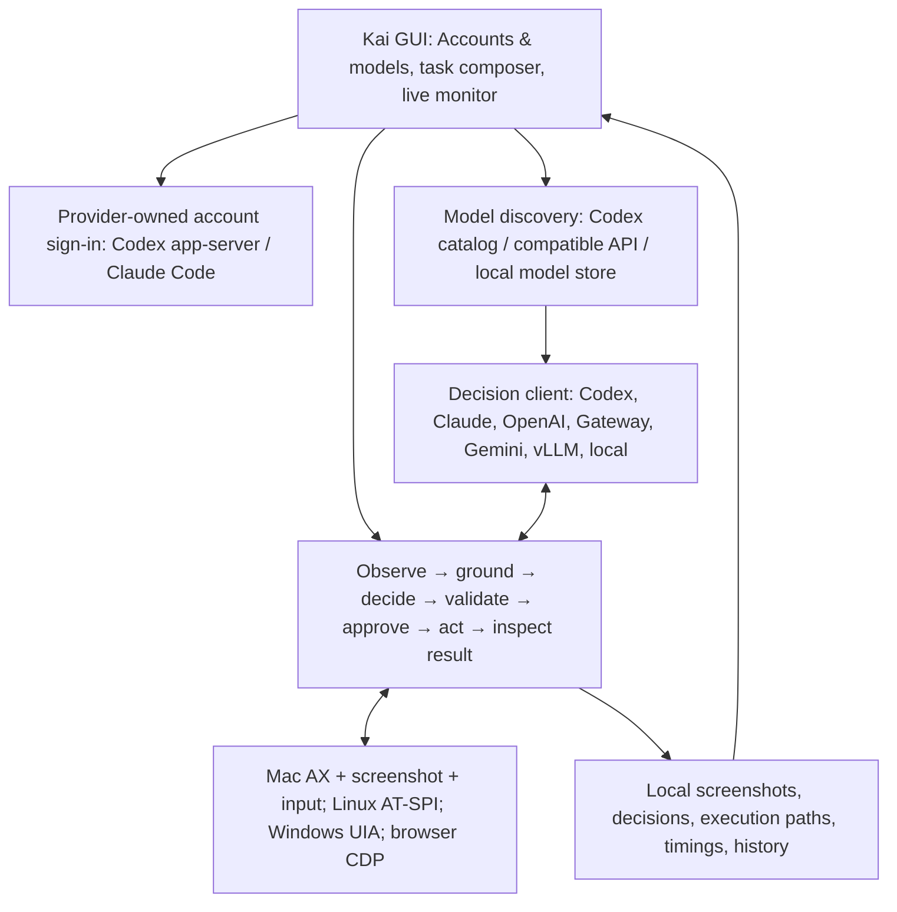

# Kai architecture review and implementation handoff — 17 October 2026

## Outcome

The accumulated computer-use architecture work is integrated with GUI provider connections and a Mac desktop testing pathway. This phase builds the software and prepares its handoff; it does not execute tests, provider inference, sign-in, or live computer actions. Compilation and packaging are build checks, not evidence of working sign-in or desktop reliability.

## How the pieces fit

`kai-core` owns model transports, protocol adapters, validation, policy, execution coordination and recording. `kai-os` implements actual perception/input, platform launchers, browser control and keychain access. `kai-app` owns the native GUI and asynchronous bridge to the engine. `kai-cli` retains developer/benchmark tooling; desktop testing is initiated and supervised in the app.

## Improvements since the synced baseline

| Area | Earlier state | Integrated state | What is still unmeasured |
| --- | --- | --- | --- |
| Native model interoperability | Generic decisions and a shared OpenAI-shaped computer contract | Strict Fara1.5/UI-TARS adapters and Holo native function-call transport; malformed/multiple/ambiguous calls are rejected | Authentic checkpoint/server compatibility, coordinate calibration and multi-step success |
| Computer execution | Existing canonical action boundary | Broader browser action handling, freshness checks, modifier/drag handling and shared safety routing | Real-app acceptance across platforms, Retina/scaled displays and dialogs |
| Safety | Existing approvals, stop controls and local checks | Domain handling, sensitive-site checks and optional screenshot injection monitor; candidate selection preserves safety constraints | False positives, recall and live intervention behavior |
| Candidate selection | Single decision or plan-level alternatives | Bounded per-step candidate sampling, agreement clusters, optional tie judge, disposable rollout tooling | Any success-rate or cost advantage over one decision |
| Browser scripting | Individual browser actions | Bounded persistent QuickJS worker and typed operations with policy/freshness checks | This remains experimental infrastructure, not a general production model-facing browser-code tool |
| Trace and dataset fidelity | Existing step traces | Native prompts, screenshots, tool definitions, candidate metadata and export support | Dataset quality and training benefit |
| Subscription access | Codex decision bridge existed but was absent from GUI selectors | Settings/Models account controls, provider-owned sign-in/status/logout and Codex model discovery; Claude Code bridge and explicitly labeled provider aliases | Live authorization, account entitlement, usage limits and inference compatibility |
| Model catalog | Static cloud choices plus local model store | Provider catalog refresh, exact IDs, compatible endpoint discovery and quick selector integration | Listed models' vision support and actual account access |
| GUI Mac evaluation | Existing live run view and developer benchmark tools | Prepared desktop-only task, shell/terminal input guards, no cached procedures/team shortcuts, local recording, screenshots, timings, pause/stop/steering | The actual GPT-5.6 Luna Mac session, then any GPT-6 Luna comparison |

There is no defensible percentage improvement in accuracy or speed yet. The earlier readiness scorecard is a qualitative engineering assessment, not a measured before/after score. Historical benchmark results in the repository are evidence for their recorded configurations only. No new results are fabricated for this build.

## Provider and credential boundaries

- Codex owns ChatGPT authorization and its credential store. Kai exchanges account/catalog metadata over local stdio and delegates decisions; it never opens or copies subscription token files. The browser sign-in is provider authorization underneath, even though the user interacts through Kai buttons. This is not an MCP integration.
- The Mac package includes the installed native Codex helper and its Apache license when available at build time. It copies executable code only, never provider configuration or credentials. Finder launches resolve bundled helpers before conventional installation paths.
- Claude Code owns its sign-in. The installed native helper is discovered automatically and is not redistributed in Kai. Its documented `sonnet`, `opus` and `haiku` aliases are labeled as aliases, not fabricated account entitlements. The decision subprocess disables tools, hooks, browser integration, MCP configuration and persistent conversation storage and uses restricted mode. Current support requires Claude Code 2.1.259 or newer.
- API-provider keys continue to use the OS keychain. A stored compatible-server key is bound to the saved endpoint origin; changing cloud origins requires entering that provider's key. Unbound loopback connections omit an old server key. Explicit `VLLM_API_KEY` remains an operator-controlled CLI override.
- A `/models` response or Codex catalog entry is discovery, not proof of vision, permission or inference access. The selected exact model ID is saved. GPT-5.6 Luna is preferred only when returned by Codex and the prior selection is absent; GPT-6 Luna is not silently substituted.

## GUI testing mode

The preset uses the real desktop, turns off team mode, executor/procedure/plan-cache shortcuts and secondary model escalation, and records the run locally. Shell actions are refused at the actuator boundary. Foreground terminal, script-runner and IDE input is refused on both legacy and canonical computer-action paths; unknown foreground identity fails closed. This is an evaluation constraint, not an OS sandbox capable of identifying every embedded browser console or custom terminal application.

Kai's existing live run screen provides the supervision pathway: Steps shows decisions/actions and execution timing; Kai's view and Earlier frames show observations; Pause, Stop and steering messages control the run. History preserves the evidence for later review. No assistant monitoring or live evaluation has been started during this build-only phase.

## Build and repository handoff

The source is organized on `shashanks-Agent/gui-provider-testing-pathway` before a safe fast-forward sync of main. Existing source, fixture and test-file changes are preserved; test files are not executed. `target`, `target-app`, `target-os` and raw local contract benchmark runs are excluded from version control. Packaging includes repository bench material only, excluding ignored local captures/results.

The Mac bundle and ZIP are under `dist/`; they are ad-hoc signed and locally installable, not notarized public releases. No release tag or automatic testing workflow is triggered. See `MAC_GUI_TESTING.md` for the deferred acceptance session.

## Build evidence for this handoff

- `cargo check --workspace`: completed successfully for kai-core, kai-os, kai-cli and kai-app.
- `cargo fmt --all --check` and Git whitespace review: completed successfully.
- `scripts/macos/bundle.sh --skip-checks`: release compilation, ad-hoc signing and ZIP creation completed successfully; bundled CLI smoke checks were skipped.
- ZIP checksum, required executable/license inventory, exclusion of raw local runs/auth files, and installed app signature: checked successfully without launching the app.
- Installed `/Applications/Kai.app`; distributable `dist/kai-macos-aarch64.zip`.
- Existing vendor Cocoa deprecation warnings and a third-party future-compatibility notice remain. They did not prevent compilation.
- Independent source review found no remaining important findings in the provider connections, clients, GUI guard and packaging changes after fixes. This is not a substitute for deferred runtime testing.
