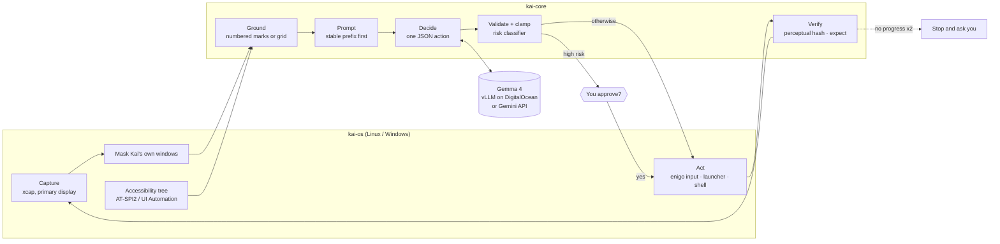
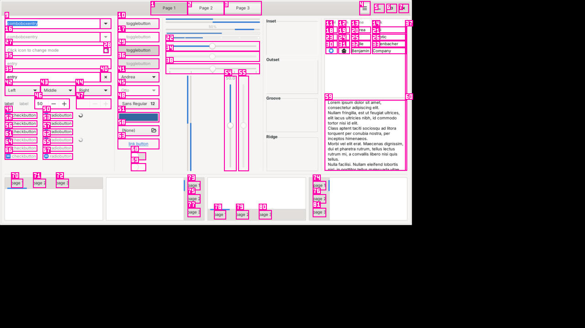

# The Kai harness

Kai's harness is the code between Gemma 4 and the computer. It lives in
`crates/kai-core` (OS-free, model-agnostic, fully tested) and `crates/kai-os`
(the real eyes and hands on Linux and Windows).

## The loop

One action per step: **observe → ground → decide → act → verify**.



### 1. Observe
`DesktopPerceptor::observe` captures the primary display and reads the
accessibility tree **in parallel**, both off the UI thread. Kai's own windows
never reach the model: Windows excludes them with
`SetWindowDisplayAffinity(WDA_EXCLUDEFROMCAPTURE)`; Linux has no such API, so
the app reports its window rectangles and they are painted over before the
frame is hashed or encoded. The frame is downscaled to Gemma 4's 280-soft-token
budget (~645K px: 1070x602 for 16:9, never over 1280 px on the long side)
with SIMD resize and JPEG-encoded at quality 75.

### 2. Ground (Set-of-Marks)
`a11y::ground` keeps visible, interactive elements, numbers them in reading
order (lines top to bottom, left to right within a line), and drops duplicate
boxes. `marks::draw` puts a box and a numbered tag on the model's copy of the
screenshot; the model also gets a text list:

```
#14 button "Save" (enabled)
#15 password "Password" (secure)
```

When the tree has fewer than two useful elements (games, canvases, some
Electron apps), Kai falls back to a **numbered grid** sized to roughly 120 px
cells. Either way the model answers with one integer `target`; it never
returns pixel coordinates. The tree read has a 600 ms budget; past it, the grid
is used.



*A real frame from `gtk3-widget-factory` on Linux: 81 elements from AT-SPI,
captured in ~20 ms, tree in ~150 ms, marks and JPEG in ~45 ms.*

### 3. Decide
One model call returns one JSON object:

```json
{ "thought": "≤ 25 words", "action": "click | double_click | right_click | type | key | scroll | open_app | open_url | wait | ask_user | done | shell",
  "target": 14, "text": "…", "keys": ["ctrl","s"], "direction": "down", "amount": 3,
  "risk": "none | low | high", "expect": "what the screen should show next" }
```

`Decision::parse` rejects unknown fields (`serde(deny_unknown_fields)`) and
tolerates code fences or prose around the object. `validate_and_clamp` then
forces every field into range: thought cut to 25 words, scroll amount 1–20,
text capped, key names normalised (`Command`→`cmd`, `Return`→`enter`), and
required fields enforced per action (`click` needs `target`, `type` needs
`text`, …). On the vLLM backend the same schema is sent as a structured-output
JSON schema, so replies are always valid; on Gemini, JSON mode plus **one
repair retry** that tells the model what was wrong.

**Multi-action steps.** The reply may carry `then`: up to 3 follow-up actions
the model is certain of (type, then Enter; open a URL, then type), plus an
optional `need_screen: true` to ask for a screenshot next step. Follow-ups run
without a model call (`reply.rs`, `engine/batch.rs`). The batch stops early on
the kill switch, a steering message, anything that would need approval (the
model proposes it again and it is asked for normally), a failed step, or a
target whose element (role + name) is no longer there on a fresh tree read.
Batched steps are recorded as `batched (no model call)` and verified by the
next observation. Old single-object replies still parse.

`shell` is Kai's addition: terminal work (files, diagnostics, builds) runs as a
command and its output is fed back into the next step, which is faster and
more exact than clicking through a file manager.

### 4. Act
**Accessibility first.** For a click or type on a marked element, Kai first
tries the element's own accessibility pattern — AT-SPI `Action` (by name:
click/press/toggle…) and `EditableText` on Linux; UIA `Invoke`, `Toggle`,
`ExpandCollapse`, `SelectionItem` and `Value.SetValue` on Windows — with no
mouse move. It works when the window is covered (tested with a GTK checkbox
and a Mousepad field under another window) and costs 1–16 ms instead of ~60 ms
for the mouse path. A mark is matched to its live object by mark, bounds and
role, so a stale frame never reaches the wrong control. Anything uncertain
(double/right click, list items, cells, password or disabled fields, non-empty
text fields, Firefox web inputs, which ignore AT-SPI text edits) falls back to
the mouse. The path used is saved per step (`a11y`, `mouse`, `keyboard`, …).

`DesktopActuator` clicks the centre of the target's box through `enigo` on a
dedicated input thread. Text longer than 32 characters is pasted through the
clipboard, and the user's clipboard is restored afterwards. `open_app` and
`open_url` are **fast paths** straight to the OS (`.desktop` entries on Linux,
`start` on Windows; only `http`, `https` and `mailto` URLs). `shell` runs in
`sh` (Linux) or PowerShell (Windows) in its own process group, with a 180 s
timeout and a 12 KB output cap, and is killed with its whole process tree when
the kill switch trips.

### 5. Verify
After acting, `settle` waits until two captures in a row match (instead of a
fixed sleep), up to a limit. The next observation's perceptual hash (dHash,
≤ 3 bits apart counts as the same screen) is compared with the last one. One
step without change adds a warning to the next prompt; two in a row stop the
run and ask the user. Three undecodable replies or failed actions in a row also
stop and ask. `wait` and `shell` steps don't count as "no progress".

**Tree-only steps.** When the last frame had a rich Set-of-Marks list (≥ 8
elements) and the last action's `expect` can be checked from text, the next
observation reads only the accessibility tree and sends no image (35–150 ms
instead of 140–270 ms on Mousepad/pcmanfm/Firefox, plus a smaller request). A
full frame is forced on the first step, every 3rd step, after any failure or
no-progress, after steering, `open_app`/`open_url`/scroll/wait, or when the
model sets `need_screen`. `Config.tree_only` turns it off (`--no-tree-only`).

**Verifier (optional).** A cheap text-only judge can rate "did `expect` hold?"
from the element list: Jev (`typesafe-ai/jev`, Vercel AI Gateway) or a small
LLM (`LlmVerifier`). p ≥ 0.85 marks the step verified; p ≤ 0.15 forces a full
frame and the careful model next step. It never touches approvals. It is off by
default: Jev is not available on a free-tier Gateway key, and the small-LLM
judge measured p50 803 ms, which costs more than it saves per step.

**Zoomed crop.** After a grid click that changed nothing, the next request
carries a 2x crop around the clicked cell with its own numbered sub-grid.

**Plan cache.** After a successful `kai run`, the leading deterministic steps
(open URL/app, safe shell, keys/typing without a target) are saved under the
normalised task. A repeat of the same task (or ≥ 0.85 word overlap with
identical names, numbers and URLs) replays them with no model call, stopping
at anything that needs approval, then hands over to the model.

**Steering.** Messages typed into a running task are folded into the next
step's prompt as "User says (mid-run): …" and force a full frame.

**Experience memory.** After every run Kai draws short lessons from the trace
(recoveries, dead ends, failing commands, your mid-run messages, false
"done"), keeps them in `<config>/memory/lessons.jsonl`, and shows the top 5
(≤ 120 words) that fit the task and the apps/sites in play at the top of the
user turn — hints only, never read by approvals or risk. No training; any
backend. See [MEMORY.md](MEMORY.md).

## Speed — what makes it fast

| Technique | Where |
| --- | --- |
| MoE `gemma-4-26b-a4b-it` (~4B active) by default; `gemma-4-31b-it` only for the one step after a failure, then back | `Engine.careful`, `engine.rs` |
| Stable system prompt and schema first, changing parts last → vLLM prefix-cache hits every step | `prompt.rs` |
| Only the last 3 steps as text history; never old screenshots | `prompt::user_turn` |
| `thought` ≤ 25 words, `max_tokens` 192, temperature 0 | `Config`, `schema.rs` |
| One keep-alive HTTP/2 connection (ALPN), warmed when the app opens | `VllmClient`, `KaiApp::after_open` |
| Fast paths that skip the model: `open_app`, `open_url`, and a skill's deterministic `steps` | `engine.rs`, `skill.rs` |
| Capture and tree read in parallel; SIMD downscale; bitmap-font marks | `desktop.rs`, `frame.rs`, `marks.rs` |
| Shell steps return the moment the command exits (no polling delay) | `shell.rs` |
| Sub-agents: independent terminal subtasks run concurrently | `orchestrator.rs` |
| Several certain actions per model call (`then`), checked against a fresh tree | `reply.rs`, `engine/batch.rs` |
| Accessibility actions instead of mouse moves (1–16 ms vs ~60 ms) | `kai-os/src/a11y/*_act.rs` |
| Tree-only steps: no capture/encode/image tokens when text is enough | `engine/observe.rs`, `kai-os/src/perceive.rs` |
| Frames sized to Gemma 4's 280-soft-token budget (≈ 645 k px, 1070×602 at 16:9) instead of 1280 px, so the server doesn't resample the marks again | `kai-os/src/frame.rs` |
| Compact element list (state only when disabled/secure, names ≤ 60 chars): per-step user turn −26 % | `element.rs`, `prompt.rs` |
| Plan cache: repeated tasks replay their known-good opening | `plan_cache.rs` |
| Executor (off by default, `--executor`): Gemma's `plan` of routine subgoals is carried out by a local 1B decision model (jevos-v4), gated by confidence, approvals unchanged; see [EXECUTOR.md](EXECUTOR.md) | `executor.rs`, `engine/execute.rs` |
| Streaming replies with measured time-to-first-token | `client/stream.rs` |
| Every step records capture · tree · encode · model · act timings | `trace.rs`, shown in the UI and saved |

Measured here (Xvfb, 4 vCPU, no GPU): observe ≈ 200 ms; **Kai's own per-step
overhead p50 65 ms / p95 93 ms** in the `replay` benchmark (model time
excluded). Model latency depends on the Droplet and is measured with
`kai bench --backend vllm` on the demo machine.

## Sub-agents

`Orchestrator` makes one planning call that splits a task into up to 8
subtasks, each `shell` or `gui`, with optional `depends_on`. Subtasks run in
waves: within a wave, terminal sub-agents run **concurrently** (bounded by a
semaphore, default 4); GUI sub-agents share the one screen and mouse, so they
take a lock and run in turn. A dependent subtask receives its parents' outputs
in its goal. A final call writes the report. Unknown or forward dependencies are
dropped, so a bad plan can't deadlock. Example: "audit my site example.com"
becomes DNS, TLS and header checks in parallel, then one summary.

## Safety

- **Risk is decided by Kai, not the model.** `risk::classify` takes the model's
  risk as a floor and raises it: a password field (from the tree) is always
  high; effect words on the target or in the action (send, buy, pay, delete,
  submit, transfer, …) make it high; destructive shell commands (`rm -rf`,
  `mkfs`, `sudo`, `| sh`, `Remove-Item`, `diskpart`, …) are high.
- **Approval levels:** ask for every action, ask for risky actions only
  (default), or autopilot — which still always asks for payments and passwords.
- **Kill switch:** `Ctrl+Alt+Esc` from any app (falls back to `Ctrl+Alt+End`
  if taken), the pointer in the top-left corner, or the Stop button. The engine
  checks the flag before every step; a running command is killed with its
  process tree. Tested: stopped within one step, every time.
- **Human checks:** a CAPTCHA, a one-time-code field, "approve the sign-in on
  your phone" or the model's `ask_user` pauses the run and asks you (desktop
  notification, mini window, dialog; the bell in a terminal). Kai never clicks
  a CAPTCHA or types a guessed code — the harness refuses those steps on every
  path. A code you give is typed into the field you saw and blanked from
  everything the model, trace and memory read. Waiting is not counted against
  the time limit; the kill switch still works. See [HUMAN_CHECKS.md](HUMAN_CHECKS.md).
- **Limits:** 40 steps / 10 minutes per task by default.
- **Privacy:** screenshots go only to the configured model endpoint. Traces
  (JSON + frames) stay in the local config folder. Keys live in the OS keychain.

## Model backends

All behind `ModelClient`:

- `VllmClient` — OpenAI-compatible `/v1/chat/completions` with image parts and
  `response_format: json_schema`, to the DigitalOcean Droplet.
- `GeminiClient` — `generateContent` with `inlineData`, `systemInstruction`,
  `responseMimeType: application/json`, `thinkingLevel: minimal` and `responseJsonSchema`; if the model rejects either
  field, it retries without it once and remembers.
- `OpenAiClient` — any OpenAI-compatible endpoint: Vercel AI Gateway
  (`google/gemma-4-26b-a4b-it`, `openai/gpt-5-mini`, …) or OpenAI. Streams and
  measures time-to-first-token; sends the schema as strict `json_schema`,
  stepping down to non-strict and then a prompt hint if the endpoint refuses
  (and remembering); low `reasoning_effort` for GPT reasoning models; waits out
  429s (free tier: 5 requests/minute/model) without counting the wait as model
  time. Gemma via the Gateway accepts `response_format` but does not enforce
  it, so the schema also goes in the prompt and the reply is validated.
- `CuaRunner` (`cua.rs`) — OpenAI's *own* computer-use loop (Responses API,
  `computer-use-preview`) driven through Kai's eyes and hands, for a labelled
  comparison. Needs a direct OpenAI key (the Gateway answers 404 for that model).
- `DecisionClient` / `JevVerifier`, `LlmVerifier` — the optional verifiers above.
- `FailoverClient` — Droplet first; on timeout, transport error or 5xx it uses
  Gemini for the step and stays there for 30 s, then tries the Droplet again.
  The status bar says which one answered.
- `MockClient` — replays recorded replies, for tests, the benchmark and offline
  UI work.

## Tests

`cargo test --workspace` (110 tests) covers: schema parsing of good, malformed
and adversarial replies; Set-of-Marks numbering, reading order, dedupe, grid
mapping and drawing; risk classification (a password field is always high,
destructive shell is high); failover switching and cooldown; skill loading and
validation against the spec; the loop end to end with `MockClient` against a
scripted fake screen (success, approvals, kill switch, no-progress stop, repair
retry, step limit, skill steps with no model call); parallel sub-agents feeding
a dependent; the shell runner (exit codes, caps, timeout, kill switch); and the
UI's run state, skill drafting and history timeline.
