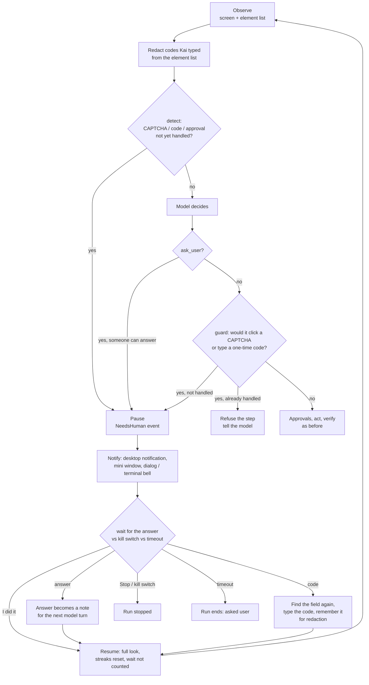

# Human checks: Kai asks you at CAPTCHAs, codes and questions

Some steps are yours alone: a CAPTCHA, a one-time code from an SMS or an
authenticator app, "approve this sign-in on your phone", or a question only
you can answer. When Kai reaches one, it **stops, tells you, waits for you,
then carries on**. It never tries to solve a CAPTCHA and never guesses a code.

This page is the system design: what triggers a pause, how the answer comes
back, and the guarantees the code and tests keep. The background research
that led here is in [RESEARCH_2026_10_FOUNDATIONS.md §6](RESEARCH_2026_10_FOUNDATIONS.md).



## What triggers a pause

| Kind | Triggered by | What you do |
|---|---|---|
| `captcha` | an element named like a live challenge: "I'm not a robot", "Verify you are human", "security challenge", "press and hold", "select all images…", or a box/field/button/image named "CAPTCHA"/"reCAPTCHA"/"hCaptcha"/"Turnstile" | Solve it on the page, press **I did it** |
| `one_time_code` | an enabled text/password field named like "Verification code", "Enter OTP", "Authentication code", "6-digit code"… (not promo, coupon, ZIP, postal, gift, referral, country/area code); or page text like "Enter the code we sent" | Type the code into Kai (it enters it for you), **or** enter it on the page and press **I did it** |
| `device_approval` | "Check your phone", "Approve the sign-in request", "Touch your security key"… | Approve it on your device, press **I did it** |
| `question` | the model replied `ask_user` | Type your answer (or **Carry on without answering**) |

Detection (`crates/kai-core/src/human.rs`) is pure, runs on every
observation, and matches **whole phrases** case-insensitively, with curly
apostrophes normalised. It is deliberately conservative:

- The invisible "protected by reCAPTCHA" badge and its links, which sit on
  many ordinary sign-in pages, **do not** pause a run. Bare product names
  count only on something you would have to work (a checkbox, field, button
  or puzzle image), never on a link or a badge frame, and never next to
  "protected by", "privacy" or "terms".
- Settings pages that merely mention "2-Step Verification" or
  "two-factor authentication" do not pause a run; only a code *field* or
  "we sent a code" text does.
- Precedence: CAPTCHA > code > device approval.
- A grid screen (no accessibility names) detects nothing; the model's
  `ask_user` still reaches you there.

## The three places the harness checks

1. **Before the model decides.** A check on screen that you have not
   handled yet pauses the run before any model call is spent on it.
2. **The model's own `ask_user`.** With someone to ask, it is a real
   question: you answer, the answer comes back as *"The user answered your
   question: …"* and the run continues. (Before this feature it ended the
   run.)
3. **The guard on every action that targets an element**, on all three
   action paths — model steps, certain follow-ups (`then`) run without a
   model call, and the executor's plans:
   - a click/type on a CAPTCHA element is never performed;
   - `type` into a one-time-code field is never performed (the model has no
     code; anything it types is a guess).

   If you already handled that check, the step is refused and the model is
   told "that is a CAPTCHA the user already handled; do not touch it".
   After 3 such refusals in a row Kai asks you what to do next.

## The answer path

```
Engine ──HumanHelper::ask(check)──► App:    desktop notification (Linux),
  ▲                                         mini window: prompt + I did it / Stop,
  │                                         main window dialog (raised for a code
  │                                         or question; steps aside after)
  │                                 CLI:    terminal bell + desktop notification,
  │                                         one line: Enter / code / answer / stop
  │                                 Bench,  none → the run ends as "asked user"
  │                                 piped:  (failure category `needs_human`)
  └────────────── HumanReply ◄──── Resolved | Answer(text) | Code(OneTimeCode) | Stop
```

`HumanHelper` is a port in `kai-core` like `Approver`; the app implements it
with the same one-shot channel approvals use (`crates/kai-app/src/agent.rs`),
the CLI with stdin (`crates/kai-cli/src/console.rs`). A dropped channel (window
closed, run stopped) is `Stop`.

### One-time codes

- `OneTimeCode::parse` accepts only 4–12 letters or digits (spaces and dashes
  dropped). Anything else is refused, so a pasted sentence or command can
  never be typed.
- `OneTimeCode` has no `Serialize`, and its `Debug` prints `[one-time code]`.
- After the pause Kai looks again, finds the field **by name and role**
  (marks are renumbered), and types the code there with the normal
  accessibility-first path. If the field is gone, nothing is typed and you
  are asked again if a code is still needed.
- The typed code is remembered for the rest of the run and **blanked from
  every later element list** (`human::redact`, applied inside
  `Engine::look` and the batch re-check), so it never reaches the model, the
  verifier, the trace, the UI events or experience memory. The step in the
  trace reads `type "[one-time code]"`.
- Caveat, stated plainly: while the code is visible on the page, it is in
  the **screenshot** like anything else on screen, and screenshots go only to
  the model endpoint you configured. Codes are single-use and short-lived.

## Guarantees (and the test that holds each one)

| Guarantee | Test |
|---|---|
| A CAPTCHA on screen pauses the run before any model call, and Kai never clicks it | `human_e2e::captcha_pauses_before_the_model_and_resumes_after_the_person` |
| Headless/bench runs end as `AskedUser` with failure category `needs_human`, spending no model call | `headless_runs_end_as_asked_user_and_say_why` |
| The model can never click a CAPTCHA, even one you already handled; Kai asks you after 3 tries | `the_model_never_clicks_a_handled_captcha_and_asks_when_stuck` |
| Certain follow-ups (`then`) never touch a CAPTCHA | `certain_follow_ups_never_touch_a_captcha_either` |
| The model can never type a guessed code | `the_model_cannot_guess_a_code` |
| Your code is typed once into the right field, and never appears in any model request, the trace JSON or any UI event | `a_code_is_typed_for_the_person_and_never_reaches_the_model_or_trace` (fails if redaction is removed — checked) |
| A code whose field vanished is not typed anywhere | `a_code_field_that_vanished_types_nothing` |
| `ask_user` is a real question; the answer comes back; the trace keeps no answer text | `ask_user_is_a_real_question_now` |
| A run asks at most 6 times | `questions_are_bounded` |
| The kill switch stops a run that is waiting for you | `the_kill_switch_works_while_waiting` |
| Nobody answering ends the run after `human_wait` (10 min) | `nobody_answering_times_out` |
| Waiting for you does not count against the run's time limit | `waiting_for_the_person_is_not_kais_time` |
| Detection: badges, promo/ZIP codes, settings links and ordinary pages never pause | `human::tests::*` (18 cases) |

Run them: `cargo test -p kai-core --test human_e2e` and
`cargo test -p kai-core --lib human`.

## Records

Every pause is kept in `trace.human` — kind, evidence, result, wait — and
**never** the answer or the code:

```json
{"step":3,"kind":"one_time_code","evidence":"textfield \"Verification code\"",
 "result":"code_typed","waited_ms":18234}
```

Results: `resolved`, `answered`, `code_typed`, `code_field_missing`,
`code_type_failed`, `stopped`, `timed_out`, `no_one_to_ask`, `too_many_asks`.
Steps you settled have `path: "human"` and backend `user (no model call)`;
experience memory never learns a lesson from them, and the plan cache never
replays them.

## Limits and settings

| | Default | Where |
|---|---|---|
| Wait for an answer | 10 minutes, then the run ends as "asked user" | `Config::human_wait` |
| Asks per run | 6 | `human::MAX_ASKS` |
| Refusals on a handled check before Kai asks you | 3 in a row | `engine/human.rs` |
| Answer length passed to the model | 500 characters | `engine/human.rs` |

## Not covered (yet)

- The experimental OpenAI native computer-use loop (`cua.rs`) keeps its own
  safety-check handling and does not use this path.
- Detection reads accessibility names. A CAPTCHA drawn on a canvas with no
  accessible name is not detected; the model is told never to solve one and
  will `ask_user`, which now reaches you.
- Windows has no desktop notification yet; the always-on-top mini window and
  the raised dialog are the signal there.
- Kai does not remember across runs that a site always challenges; that
  would be an experience-memory fact ("ask before starting").
