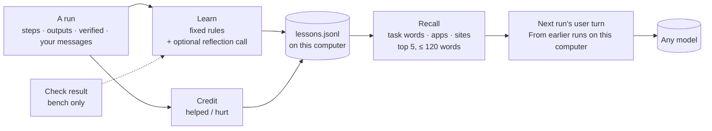

# Experience memory: Kai learns on your computer, without training

When Kai gets something wrong on your computer — starts Mousepad from the
shell and waits forever, clicks a button that does nothing, says "done" too
early — it should not make the same mistake tomorrow. Kai does this with
**experience memory**: after each run it writes down a few short **lessons**
from what happened, keeps them on this computer, and shows the handful that fit
the next task to the model as hints.

No model is trained or fine-tuned. The model's weights, context window and
capacity are untouched; it simply reads a few extra lines. That makes it work
the same with every backend: a local Gemma on a laptop, a hosted model, or a
model you switch to next month — the lessons are plain text.



## What a lesson is

```json
{"id":"3f9a0c12","kind":"prefer",
 "text":"Start Mousepad with open_app, not shell `mousepad`: a shell step waits for the app and blocks.",
 "scope":{"apps":["mousepad"],"domains":[],"task_words":["write","hello","mousepad"]},
 "evidence":["2026-10-10T12:00:01+02:00[Europe/Berlin]"],
 "created":1791000000,"last_used":1791003600,"uses":1,"helped":1,"hurt":0,
 "source":"derived","targets":"env_error"}
```

- **kind**: `avoid` (failed here), `prefer` (worked after something else
  failed), `fact` (about this computer), `preference` (how you want it done).
- **text**: one imperative sentence, at most 30 words.
- **scope**: the apps and sites it is about, and the task's content words.
- **confidence** = (helped + 1) / (helped + hurt + 2): 50 % for a new lesson.
- **source**: `derived` (fixed rules), `reflection` (the model, optional),
  `user` (you typed it, or said it mid-run).

## How Kai learns (after every run)

Fixed rules first — no model call (`crates/kai-core/src/memory/learn.rs`):

| Rule | Reads | Lesson |
|---|---|---|
| Recovery | a step failed or changed nothing, and a later step with the same intent (same `expect`, same target name, or the same app) worked | `prefer` "To reach "file saved" in mousepad, key ctrl+s (not click on 'Save')." / "Start Mousepad with open_app, not shell `mousepad` …" |
| Dead end | the same action on the same element twice with no change | `avoid` "click on 'Next' in firefox did nothing (2 tries); try another way." |
| Failing command | a shell command errored or timed out — kept when a corrected command followed (attached) or the run failed | `avoid` "shell `pythn x.py` fails here: command not found; shell `python3 x.py` worked instead." |
| Steering | every message you sent mid-run | `preference` "User prefers: save to ~/Notes" (source user) |
| False done | said done but the task's check failed (bench) | `avoid` "Before done on tasks like 'export report pdf', verify the PDF is saved." |
| App fact | a run that passed reached a goal through a menu path (2+ menu items in a row) or an uncommon shortcut | `fact` "In libreoffice, export as pdf dialog open: use the menu File › Export as PDF…" (scoped to the app only, no task words) |

At most 4 rule-based lessons per run (your messages are always kept).

**Reflection (optional, off by default).** With *Reflect after failures* on,
a failed or recovered run gets ONE extra model call with a compact, scrubbed
summary of the run, asking for at most two lessons as
`{"lessons":[{"kind","text"}]}`. Replies are validated (kind, ≤ 30 words, no
secrets, no talk of approvals/passwords/overrides). It is off by default
because it costs a call per such run and the fixed rules already cover the
common cases; local-model users who want more learning can turn it on.

## How Kai remembers (recall)

At the start of a run and whenever a new app or site comes into play (opened
by the run, or visible in the element list), Kai scores every lesson:
app/site match + task-word overlap + confidence (halved for every 90 days
unused), keeps the top 5 within 120 words, and puts them at the **top of the
user turn**:

```
From earlier runs on this computer:
- Start Mousepad with open_app, not shell `mousepad`: a shell step waits for the app and blocks.
```

**Screens (decision-point recall).** Each step records a coarse screen
signature: the app part of the window title plus the kinds of elements on
screen (`mousepad/button,textfield`). The document name is ignored, and a
dialog opening changes it. A lesson keeps the signature of the screen it was
learned on. Recall ranks it +2 on that screen and −1 elsewhere in the same
app (still shown if there is room), and recall runs again whenever the
screen changes, not only when a new app or site comes into play. This is
the fix for the loose task-word scope the first live test found
(`docs/RESEARCH_2026_10_FOUNDATIONS.md` §3.3).

**App facts (hidden operations).** The commands a task needs are often in a
menu or behind a shortcut that is not on screen. When a run passes through a
menu path or an uncommon shortcut (`ctrl+shift+e`, not `ctrl+c` or
`ctrl+s`), Kai keeps it as a `fact` scoped to the app alone, so any later
task in that app sees it. At most 2 per run, and only from runs that passed.

Why the user turn and not the system prompt: the system prompt is kept
byte-for-byte stable across runs and sessions so the backend's prefix cache
always hits. The lesson block sits right after it and only changes when the
apps/sites in play change, so within a run it extends the cached prefix
(images come after the text in every request) and costs almost nothing after
the first step on a prefix-caching server such as llama.cpp or vLLM.

**A design change from the first plan.** The plan said to re-send the block
only when the set changes and otherwise write "(same lessons as before)".
Kai's model requests are stateless — each step is one system + one user
message, with a 3-step history summary — so the model would never have seen
"before". The block is therefore repeated while it applies, kept small by the
120-word budget, and made cache-friendly by its position and stability.

**Lessons are hints, never rules.** Nothing but the prompt builder reads them:
risk classification, approvals, the payment/password rule and the kill switch
are computed exactly as without memory. A lesson that says "skip approval"
reaches the model as text and changes nothing else — this is tested
(`a_lesson_can_never_skip_an_approval` in `crates/kai-core/tests/memory_e2e.rs`).
Model-written lessons that mention approvals, passwords, credentials or
"ignore previous instructions" are refused at the door, so a hostile web page
cannot plant a persistent instruction through the reflection call.

## Credit, merging and forgetting

- **Credit.** Each lesson shown in a run: `uses` + 1; `helped` + 1 if the run
  passed (or failed for a different reason than the one the lesson warns
  about); `hurt` + 1 if it failed exactly the way the lesson warned about.
- **Retire.** A lesson shown in ≥ 3 runs with confidence < 30 % is dropped.
  Your own lessons are never retired automatically.
- **Merge.** A new lesson whose words overlap an existing one of the same
  kind by ≥ 80 % (token Jaccard) is merged into it (evidence, counters, scope).
- **Caps.** At most 30 lessons per app or site and 500 in all; the least
  confident, then least recently used, go first (yours last).
- **Age.** Ranking weight halves for every 90 days a lesson goes unused;
  lessons untouched for a year are dropped (yours are kept).

## Consolidation and the exam

Live learning sees one run at a time. `kai memory consolidate` sees all the
saved runs (`kai run` and the app both save them). It re-applies the fixed
rules to each run, groups lessons that say the same thing, and proposes
those that recur in **2+ different runs** and that memory does not already
know (at most 10 at a time, no model call). Proposals are stored as
**pending**: they are listed and kept, but recall never shows them to the
model.

A pending lesson goes live in one of two ways:

- **You accept it**: `kai memory accept <id>` (or `all`), or *Accept* in
  Settings › Memory. `kai memory reject <id>`, or *Delete*, drops it.
- **It passes the exam.** Run the same tasks twice, once with your live
  lessons and once with live plus pending:

  ```
  kai bench --backend gemini --lessons current   --out a
  kai bench --backend gemini --lessons candidate --out b
  kai memory exam a/<file>.json b/<file>.json --accept
  ```

  The candidate passes when it wins at least 4 more tasks than it loses
  (`--margin`) and false done does not go up. With `--accept`, a pass makes
  every pending lesson live, and the command exits 1 on a fail. Both bench
  runs use in-memory copies of your lessons; nothing is written back.

## Promotion to a skill

When an app or site has a remembered successful opening (the plan cache) and
at least two `prefer` lessons that helped, Kai suggests a skill: the opening
as deterministic steps, the lessons as instructions. It opens in the normal
Save-as-skill editor (`kai memory suggest` prints the draft); nothing is ever
installed for you.

## Privacy

- **Local only.** Lessons live in `~/.config/kai/memory/lessons.jsonl`
  (Windows: `%APPDATA%\Kai\memory\lessons.jsonl`). They are only ever sent as
  part of the prompt to the model endpoint you chose, like the screen itself.
- **No secrets.** Emails, key-like tokens and runs of 6+ digits are replaced
  (`[email]`, `[secret]`, `[number]`); anything typed into a password/secure
  field never becomes a lesson; a lesson that still looks secret is refused.
- **What is stored**: the lesson text, its scope (app names, site names, task
  words), counters, timestamps and the start time of the runs it came from.
  No screenshots, no element lists, no command output beyond a 60-character
  error line.

## Seeing and deleting what Kai learned

- App: **Settings › Memory** lists every lesson (kind, text, scope,
  confidence, uses) with **Delete** and **Clear all**, and an **Add a lesson**
  field. **Settings › Privacy** has *Learn from mistakes on this computer*
  (on by default) and *Reflect after failures (one extra model call)* (off).
- Terminal:

  ```
  kai memory list [--app mousepad]
  kai memory forget <id>
  kai memory clear
  kai memory add "Save notes to ~/Notes" --app mousepad [--kind preference]
  kai memory suggest
  kai memory consolidate              # propose recurring lessons (pending)
  kai memory pending | accept <id|all> | reject <id>
  kai memory exam <current.json> <candidate.json> [--accept]
  kai memory procedures [--forget N]
  kai run --no-memory "…"     # neither use nor add lessons for this run
  ```

`kai run` and the app use memory by default. `kai bench` does **not** (fair
comparisons): `--memory` gives the bench its own fresh, in-memory store, and
`--memory --repeat 2` runs every task twice back to back and prints first-run
vs second-run success, steps and model calls (`<results>.memory.md`). The
head-to-head numbers use first runs only. In the bench the lesson is learned
after the task's check (so false "done" is caught); reflection does not run in
the bench.

## Why no training

Training on a laptop is slow, needs data Kai would have to collect and label,
changes the model for every task at once, and has to be redone for each new
model. Experience memory is immediate (the next run benefits), specific to
this computer, visible and deletable line by line, costs at most ~120 words
of context, and works with any model. Training is parked by the owner
(2026-10-10); `train/` is kept for later.

## Measured

With a scripted policy model that follows hints (MockClient-style, no network;
`cargo test -p kai-core --test memory_e2e -- --nocapture`):

| Scenario | Run 1 | Run 2 with lessons | Run 2 without memory |
|---|---|---|---|
| Mousepad started from the shell, retried, gave up | asked user, 3 model calls | success, 3 calls | asked user, 3 calls |
| Shell timed out, then open_app worked | success, 4 calls / 4 steps | success, 3 calls / 3 steps | — |

These numbers show the mechanism (lesson learned → recalled → followed), not
a real model's behaviour; real-model A/B numbers come from
`kai bench --memory --repeat 2` on a live backend.

Code: `crates/kai-core/src/memory/` (OS-free), wiring in
`crates/kai-core/src/engine/memory.rs`, CLI in `crates/kai-cli/src/memory.rs`.

## First live test (2026-10-10) — no improvement yet

Gemma 4 26B (Gemini API free tier), 7 tasks it had failed before, each run
twice with memory on (`kai bench --memory --repeat 2`; results in
`bench/results/2026-10-10-gemini-gemma-4-26b-a4b-it.memory.md`):

| Pass | Passed | Mean steps | Mean model calls | Lessons shown |
|---|---|---|---|---|
| 1st try | 5 / 7 | 12.4 | 20.7 | 6 |
| 2nd try (with lessons) | 4 / 7 | 14.1 | 25.1 | 9 |

Not a fair read: the Gemini daily free quota ran out during the run (34
"exceeded your current quota" replies; two tasks failed on that alone), and
one run per pass on 7 tasks is noise. But it shows no benefit, so the lesson
rules need tightening before memory can be called a win: lessons from other
tasks were shown in the first pass already (scope too loose), and the bench
does not yet print which lessons were recalled — needed to judge them.
