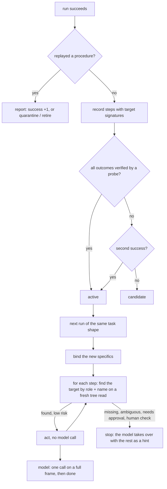

# Procedures: replaying a whole run with no model call

Ranked plan #4 in [RESEARCH_2026_10_FOUNDATIONS.md](RESEARCH_2026_10_FOUNDATIONS.md)
(§3.1, after EchoPath). **Off by default.** Turn it on with `--procedures`
(`kai run`, `kai bench`) or *Settings › Safety*.

The plan cache keeps only the untargeted opening of a run (open a URL, press
keys). A procedure keeps **the whole run up to `done`**, including clicks
and typing into named elements. A repeat of the task, even with different
specifics, then runs with no model call, and the model makes one call at the
end to check the screen and say `done`.

## What is stored

`<config>/procedures/<hash>.json`, one file per task shape:

- **Steps**: the action, its text and keys, and the target's **signature**
  (role and name). Never the mark number, which changes every frame.
- **Shape and slots**: the task's specifics become slots: quoted text and
  any word with a digit, a dot, `/` or `@` (addresses, file names, URLs,
  numbers). `Email alice@x.com about "lunch"` has the shape
  `email <slot> about <slot>`.
- **Lifecycle**: `candidate`, `active`, `quarantined`, `retired`, with
  success and failure counts.

Only the leading steps that can replay are kept. Recording stops at the
first step that needed approval, met a human check, failed, was high risk,
or acted on an element with no usable signature (a grid cell, an unnamed or
secure element).

## Replay

1. **Match.** The new task must have exactly the same shape. Only `active`
   procedures replay.
2. **Bind.** Each changed specific is replaced in the steps' text and target
   names. If a changed specific is used by **no** step, the task means a
   different job, so the procedure does not match. A value going into a
   shell command must be plain (letters, digits, `./@-_:+,=%`, not starting
   with `-`). Otherwise there is no match.
3. **Act.** For a targeted step, Kai reads the tree (no screenshot) and
   looks for exactly one enabled element with the same role and name. The
   step goes through the same approval check and human-check guard as a model
   step. Missing, ambiguous, approval needed, a CAPTCHA, code or suspicious
   text on screen, a failed action, or a message from you: the replay stops
   there. Untargeted steps (open an app or URL, keys, typing into the focused
   field, a shell command) read the tree too, so the screen check and the
   approval check (a focused password field included) run before every step.
4. **Hand over.** The model gets a full frame and a note: either "all N
   steps ran, check the screen and reply done", or "k of N ran, it stopped
   because …, the remaining steps were …", as a guide, not as orders. `done`
   still goes through the DONE gate when outcomes are on.

At the end, a replayed run that succeeded adds a success. One that did not
quarantines the procedure. A second failure in all retires it, and a retired
procedure is never re-recorded. A fresh model-led run that succeeds brings a
quarantined procedure back as a candidate, or as active if its outcomes were
verified.

## Guarantees

| Guarantee | Test |
|---|---|
| Nothing replays before it is proven (verified outcomes or two successes) | `procedure_tests::one_unverified_success_is_only_a_candidate`, `a_verified_run_is_active_at_once` |
| A waived gate ("I did it") is not verification | `a_verified_run_is_active_at_once` |
| Targets are found by role and name, not mark numbers | `procedure_e2e::a_known_task_replays_with_new_specifics_and_one_model_call` |
| A missing target runs nothing blind and hands over with a hint | `procedure_e2e::a_missing_target_hands_over_to_the_model` |
| A failed replay is quarantined and no longer replays; two failures retire it | `procedure_e2e::a_replay_that_fails_is_quarantined`, `procedure_tests::failed_replays_quarantine_then_retire` |
| Different words never replay; a specific no step uses cannot be rebound | `procedure_e2e::different_words_never_replay`, `procedure_tests::a_specific_no_step_uses_cannot_be_rebound` |
| A rebound value cannot inject shell syntax | `procedure_tests::shell_slots_refuse_anything_a_shell_reads_specially` |
| Approvals, human checks, high risk and unsigned targets are never recorded | `procedure_tests::approvals_human_checks_and_high_risk_end_the_procedure`, `a_targeted_step_without_a_signature_ends_the_procedure` |
| Off records and replays nothing | `procedure_e2e::off_records_and_replays_nothing` |

## Not done yet

- **Crops and template matching.** EchoPath re-aims by matching a crop of the
  target when the accessibility signature fails. Kai stops and hands over
  instead.
- **Outcome probes per step.** Only the run's final outcomes decide whether
  a procedure is active. A failing step is caught by the target lookup and
  by the final model check, not by a probe after each step.
- **Measured gain: none shown yet.** Live on 2026-10-12 (Gemma 4 26B, six
  tasks, `--repeat 3`, one run per side): 5/6 passed either way; model calls
  per task fell from 11.5 on the first pass to 9.8 on the third with
  procedures, and stayed 8.5 → 8.8 without. One run per side cannot separate
  that from noise, and no replay was seen failing on a renamed target, so
  visual re-aim is not built. The paper's numbers (about 96% fewer tokens
  and 60% less time on repeats) are not Kai's.
  [`bench/results/2026-10-12-live.md`](../bench/results/2026-10-12-live.md)

`kai memory procedures` lists them. `kai memory procedures --forget N`
deletes one.
