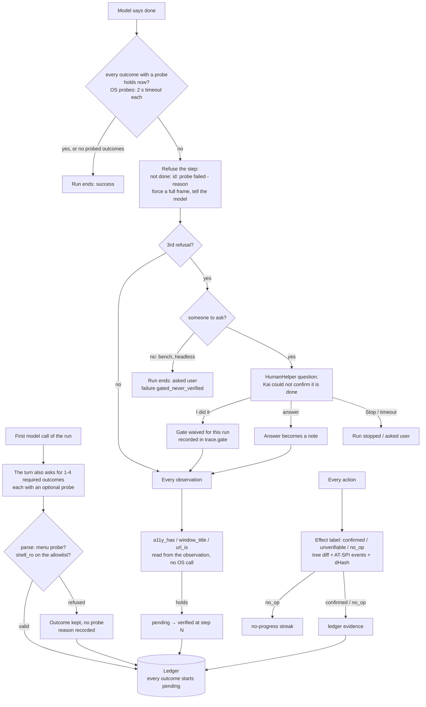

# Verification: an outcome ledger and a DONE gate

Kai's most common measured failure is **false done**: the model says `done`,
but the task's own check fails (`web-form-submit` on Gemma 4 31B,
`bench/results/2026-10-10-gemini-gemma-4-26b-a4b-it.json`). This page is the
design of the harness-side fix: before Kai accepts `done`, it checks the
outcomes the model itself said would be true, with read-only probes. The model
proposes the checks, but it can never mark them passed.

It follows StructAgent ([arXiv 2607.11388](https://arxiv.org/abs/2607.11388)),
summarised in [RESEARCH_2026_10_FOUNDATIONS.md §2](RESEARCH_2026_10_FOUNDATIONS.md).
StructAgent itself is much larger: two verifiers, recovery diagnosis and
milestones. Kai keeps three parts of it: the ledger, the deterministic probes
and the DONE gate. Stage 2 adds a cheap per-action effect label.

**Off by default.** `Config::outcomes` is false, and `kai run --outcomes`,
`kai bench --outcomes` and *Settings › Safety › Check the result before
"done"* turn it on. It stays off until a live-model benchmark shows it helps.
See [Measured](#measured) for why that benchmark has not been run yet.



## The ledger

At the run's first model call (no extra call: it is the call that picks the
first action), the user turn carries one more instruction and the reply schema
one more optional property, `outcomes`:

```json
{"thought":"open the form","action":"open_url","text":"http://127.0.0.1:8765/contact.html",
 "risk":"none","expect":"contact form",
 "outcomes":[
   {"id":"sent","description":"the contact form was submitted",
    "probe":{"kind":"window_title","pattern":"thank you"}},
   {"id":"note","description":"a note file says hello",
    "probe":{"kind":"file_contains","path":"~/kai-note.txt","text":"hello"}}]}
```

- 1–4 outcomes. Extra ones are dropped. The `id` is cleaned to
  `[a-z0-9_-]`, at most 24 characters (`o1`… when missing or repeated). The
  description is cut to 120 characters.
- A probe from outside the menu, a bad regex, or a `shell_ro` command not on
  the allowlist does **not** drop the outcome. The outcome is kept without a
  probe, and the reason is recorded (`probe_refused`). So a refused probe can
  never be used to switch the gate off.
- Status is `pending`, `verified` or `reverted`. Every outcome starts
  `pending`. The parser has no status field: a `"status":"verified"` sent by
  the model is ignored like any unknown key. `outcomes` in any later reply
  are ignored too, so the ledger is fixed once the first call returns.
- **Only probes and the user change status.** Observation probes run on every
  observation. OS probes run only when `done` is claimed. A probe that held
  sets `verified` (with the step). At a `done` claim every probe runs again,
  and a verified outcome whose probe fails now becomes `reverted`. Memory,
  the model's thought, its `expect` and the text verifier never write to the
  ledger.

## The probe menu

| Probe | Reads | Holds when | Cannot |
|---|---|---|---|
| `file_exists(path)` | the file system (kai-os) | the path exists (file or folder) | see inside the file; follow globs (`*` is literal) |
| `file_contains(path, text)` | the first 4 MB of the file (kai-os) | `text` appears in it, case-insensitive | read binary formats (`.xlsx`, `.odt`, `.pdf` are zip/binary: use a `shell_ro` `grep -a` only if the text is stored plainly) |
| `a11y_has(role, name)` | the observation's element list (no OS call) | an element whose role matches (`any` matches all) has `name` in its name or value, case-insensitive | see static text: the element list keeps **interactive** elements only (buttons, links, fields, …), so "Thank you" in a heading is invisible to it; see secure fields' values |
| `window_title(regex)` | the active window's title, taken during the tree read Kai already does (AT-SPI on Linux, `GetWindowTextW` on Windows) | the regex matches, case-insensitive | see a title when no window reports itself active over AT-SPI (some apps, Wayland-only apps); it fails as "window title unknown" then |
| `url_is(regex)` | the browser's address bar value in the element list (no OS call) | an address/URL/location field's value matches | see the URL when the address bar is hidden (full screen, kiosk) or not exposed; Kai has no browser-protocol access |
| `shell_ro(cmd)` | a read-only command, run **without a shell** (kai-os) | the last stage exits 0 | write, redirect, substitute, chain, glob, or run anything off the allowlist (below) |

`url_is` reads the observation, not the OS. The plan in RESEARCH §2 put it
among the OS probes, but Kai can only see the URL through the address bar's
accessibility value, and the observation already carries that.

### `shell_ro`: the allowlist

`crate::shell_ro::ReadOnlyCmd` can only be built by `ReadOnlyCmd::parse`,
and kai-os only accepts that type, so an unchecked command cannot reach the
OS. Rules:

- At most 300 characters and at most 3 stages joined by `|`. Every stage
  must be on the allowlist. Mixing POSIX and PowerShell stages is refused.
- Refused anywhere in the string: `;` `&` `>` `<` `` ` `` `$` `(` `)` `{`
  `}` newline. That rules out chaining, background jobs, redirection and
  command or variable substitution. `||` makes an empty stage and is refused.
- POSIX programs (bare names only, no paths): `ls`, `stat`, `grep`, `cat`,
  `test`, `wc`, and `xdotool`. Every `xdotool` argument must be one of
  `getactivewindow`, `getwindowfocus`, `getwindowname`, `%1`, `%@`, or a
  window id. `search`, `key`, `type`, `windowkill` and the rest are refused.
- PowerShell: `Get-<Noun>` cmdlets and `Test-Path`. `@`, `[`, `]` and `::`
  are also refused (splatting, type literals, static calls), and so are the
  typographic quotes `‘ ’ ‚ ‛`, which PowerShell reads as `'`. Parameters
  (`-Path`) stay bare, and every other argument is passed single-quoted.
- Quotes group words, and nothing is expanded. A leading `~/` is replaced by
  the home folder, which is the only expansion.
- kai-os runs POSIX stages with `tokio::process` directly, pipe to pipe, with
  stdin closed, and kills them when the 2 s timeout fires (`kill_on_drop`).
  PowerShell runs as `powershell -NoProfile -NonInteractive -Command` with
  the rebuilt line.

## The DONE gate

When the model replies `done`:

1. No ledger, no outcome with a probe, or a gate the user waived: accepted
   as before.
2. Otherwise every outcome with a probe is checked now: observation probes
   against this step's observation, OS probes through `ports::Probe`, each
   under `Config::probe_timeout` (2 s; a timeout counts as failed). If there
   is no `Probe` port, OS probes fail with "no probe available" (fail closed).
3. All held → `success`. Any failed → the step is refused. It is recorded
   with `path: "gate"` and `verified: false`. The model's next turn starts
   with `not done: sent: window_title(thank you) failed (title is "Contact -
   Mozilla Firefox")`, the next observation is a full frame, and
   `trace.gate` gets the record.
4. After `MAX_GATE_REJECTIONS` (3) refusals Kai asks through the existing
   `HumanHelper` path ([HUMAN_CHECKS.md](HUMAN_CHECKS.md)): "Kai thinks the
   task is done but could not confirm: …". **I did it** waives the gate for
   the rest of the run (recorded as `waived_by_user`; the outcomes stay
   unverified in the trace). An answer goes back to the model as a note. With
   nobody to ask (bench, headless) the run ends as `asked_user` with failure
   category `gated_never_verified`.

Probe reasons are short and say what happened ("exit 1", "not found", "no
match", "timed out after 2 s", "title is …"). Raw command output never goes
into the trace, the UI or the model. Every reason and every probe argument
passes through the same one-time-code redaction as the element list, so a
code Kai typed for the user never appears.

## Per-action effect (stage 2)

After each action, the next observation labels it. No model is called.

| Label | When |
|---|---|
| `confirmed` | the element list changed; or accessibility events came from the active app after the action (AT-SPI on Linux: state, text, property, children, window, document-load events); or a `shell` step exited 0 |
| `no_op` | the element list is the same, no events arrived (or events are not available), and on full frames the screen dHash is the same |
| `unverifiable` | anything else: the pixels changed but the list did not and no event came, a grid screen changed, `wait`, a failed shell command |

`no_op` is now what increments the no-progress streak. Without events this
is exactly the old dHash-and-list rule, so behaviour does not change. Events
add one rescue: an action that changed state the list does not show (a
checkbox toggle, a selection) used to count as "no progress", and now counts
as `confirmed`. Each step stores its label in `StepRecord::effect`. The ledger
keeps `confirmed` and `no_op` as evidence: every outcome records the steps
confirmed since the last ledger change (`evidence`), and a gate refusal right
after a `no_op` action says so ("your last action changed nothing").

Windows: UI Automation events are **not** wired. `Perceptor::ui_events`
returns `None` there, so the labels come from the tree diff and dHash. The
UIA event handlers could not be compile-checked in this Linux container (the
cross-build stops at `ring`, which needs the MSVC headers), and untested
Windows code would put CI at risk.

## Records

```json
"outcomes":[{"id":"sent","description":"the contact form was submitted",
  "probe":"window_title(thank you)","status":"verified","verified_at":6,
  "by":"probe","evidence":[4,5]}],
"gate":[{"step":4,"failed":[{"outcome":"sent","probe":"window_title(thank you)",
  "reason":"title is \"Contact - Mozilla Firefox\""}],"last_effect":"confirmed"}]
```

`by` is `probe` or `user` (waived). `probe_refused` holds the reason a probe
was not accepted. The failure taxonomy ([DATASET.md](DATASET.md)) gains
`gated_never_verified`: the gate refused `done` at least once and the run did
not pass, with at least one probed outcome never verified. It is checked right
after `false_done`, which still means "the gate accepted (or was off), but the
check failed". `kai bench` shows both counts in the summary table and in every
report.

## Guarantees (and the test that holds each one)

All of these go through the real engine, with the mock model and the fake
screen and hands from `tests/common` (the same fakes `human_e2e.rs` uses), in
`crates/kai-core/tests/verify_e2e.rs`, unless marked *lib*. For each test I
removed its guard on purpose (the change is in the last column), saw the test
fail, then put the guard back. The script that did this is in
[`bench/results/2026-10-12-verification.md`](../bench/results/2026-10-12-verification.md).

| Guarantee | Test | Guard removed → test fails |
|---|---|---|
| `done` is refused when a probe fails; a full frame is forced and the model is told why | `done_is_refused_while_a_probe_fails` | `claim_done` accepts without checking |
| The model cannot mark an outcome verified (a `status` in its reply, `outcomes` in later replies, its own claims) | `the_model_cannot_mark_an_outcome_verified`, *lib* `ledger::tests::the_model_cannot_set_a_status` | `from_raw` reads `"status":"verified"` |
| A refused probe keeps its outcome, so a bad probe cannot switch the gate off | *lib* `ledger::tests::a_refused_probe_keeps_the_outcome` | the outcome is dropped on a bad probe |
| `shell_ro` refuses writes, chaining, redirection, substitution and anything off the allowlist | *lib* `shell_ro::tests::writes_and_anything_off_the_allowlist_are_refused` (50 commands) | the forbidden-character check |
| A refused command never reaches the OS probe port; OS probes go through it | `os_probes_go_through_the_port_and_a_write_never_reaches_it` | the program allowlist |
| Probes time out (2 s by default) and count as failed | `a_hanging_probe_times_out_and_fails` | the `tokio::time::timeout` around the port (the test then hits its own 10 s guard) |
| Gate refusals are bounded: after 3, Kai asks the person; with nobody to ask the run ends `asked_user` / `gated_never_verified` | `gate_refusals_are_bounded_then_kai_asks`, `headless_gate_ends_as_gated_never_verified` | the bound (never ask) |
| "I did it" waives the gate for the run, recorded as `by: user` | `i_did_it_waives_the_gate` | the waiver |
| No outcomes means unchanged behaviour: same actions, steps, model calls and turns; only the first turn carries the request | `no_outcomes_means_unchanged_behaviour`, and all 361 tests that existed before | — |
| A one-time code Kai typed never reaches the trace JSON, the UI events or any model turn, even when the model writes it into an outcome | `nothing_secret_reaches_the_trace` | `redact_text` |
| Accessibility events turn an action with no visible change into `confirmed`, not "no progress" | `events_confirm_an_invisible_change` | `no_op` ignores events |
| With no events, `no_op` is the old rule (two unchanged steps stop the run) | `no_events_no_change_is_a_no_op` | — |
| kai-os: file probes never write; `shell_ro` runs without a shell and keeps only the exit code; a dropped probe kills its children | `kai-os` `probe::tests::*` (Linux) | — |

Run them: `cargo test -p kai-core --test verify_e2e`,
`cargo test -p kai-core --lib -- ledger shell_ro probe effect gated` and
`cargo test -p kai-os probe`.

## Limits and settings

| | Default | Where |
|---|---|---|
| Feature switch | off | `Config::outcomes`, `--outcomes`, Settings › Safety |
| Outcomes per run | 1–4 | `ledger::MAX_OUTCOMES` |
| Probe timeout | 2 s each, run one after another (≤ 8 s per `done` claim) | `Config::probe_timeout` |
| Gate refusals before Kai asks | 3 | `engine/gate.rs` `MAX_GATE_REJECTIONS` |
| `file_contains` read limit | 4 MB | `kai-os/src/probe.rs` |
| `shell_ro` length / stages | 300 chars / 3 | `shell_ro.rs` |
| Extra reply tokens on the first call | +256 (room for the outcomes) | `engine/gate.rs` |

## Not covered (yet), and what this cannot do

- **The model writes the probes.** A probe that is always true
  (`file_exists("/")`) gets through the gate. The gate catches a wrong
  "done" only when the model's own probe is sharp. Nothing here forces that,
  so the measured gain depends on the model.
- `a11y_has` cannot see static text (see the table). For a web confirmation
  the window title or URL is usually the better probe.
- `shell_ro` can read any file the user can read (`grep -q` on a private
  file, for example). Only the exit status and a short reason are kept, never
  the output.
- No milestone verifier or replanning (StructAgent's other parts). A
  simple recovery diagnosis exists separately and is off by default
  (`--recover`, [HARNESS.md](HARNESS.md)); it does not touch the ledger.
- The OpenAI native computer-use loop (`cua.rs`) and Team sub-agents do not
  use the ledger.
- Windows has no UI Automation events yet (above).

## Measured

Numbers and method: [`bench/results/2026-10-12-verification.md`](../bench/results/2026-10-12-verification.md).

- **Not measured: whether false done drops.** This container has no model
  key and no browser or GUI apps, and recorded replies name no outcomes. So
  the gate never fires in any benchmark that could run here, and the live
  before/after run the shipping rule asks for was not possible.
- **Measured: it costs nothing and breaks nothing when it does not fire.**
  Mock (30 tasks) and a real-desktop replay under Xvfb (20 terminal/mixed
  tasks, twice before and twice after, once with `--outcomes`) gave the same
  pass rate (30/30 and 19/20, with the same setup failure in every run), the
  same steps per task, the same model calls and the same per-task results.
  Step p50 was 104–110 ms after and 109–110 ms before.
- **So no gain is claimed, and the feature stays off by default.** Turn it
  on only after `kai bench --backend gemini --model gemma-4-26b-a4b-it`, run
  with and without `--outcomes` on the same tasks (at least twice each),
  shows false done going down without the pass rate going down.
- **Live, 2026-10-12 (Gemma 4 26B, 14 tasks, two runs each side):** false
  done 1 with and 1 without, 26/28 vs 27/28 passed, and 69% more steps
  (36 gate refusals). The false done that got through (`open-folder`) named
  no outcome a probe could check. It stays off.
  [`bench/results/2026-10-12-live.md`](../bench/results/2026-10-12-live.md)
